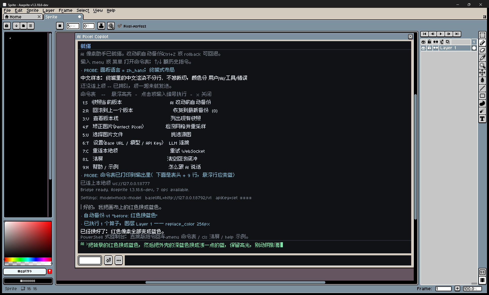
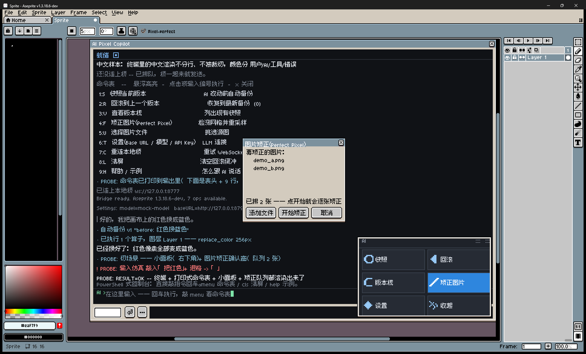

# AI Pixel Copilot

给 Aseprite 加一个控制台式 AI 对话框：用自然语言操作画布、调用 Perfect Pixel Studio
把 AI 生成的"伪像素画"矫正成真像素画、改动前自动备份、可回滚、记住用过的色值与场景。

```
Aseprite (Lua 扩展)  <--WebSocket-->  本地 Node 桥  <--HTTPS-->  LLM（OpenAI 兼容）
```

不需要改 Aseprite 源码、不需要重编译。Aseprite 的 Lua 只有 WebSocket 没有 HTTP，
所以必须有一个本地桥进程负责调 LLM。



<sub>↑ 终端式面板：命令表是"打印"出来的，鼠标悬浮变蓝，点一下或敲编号执行。
底部只有输入框 + ⏎ + […]。</sub>



<sub>↑ 小面板贴在**对话窗自己的右下角**，图标按钮对应主面板的功能，按住顶部把手可拖动。</sub>

## 能力

- **画布算子**（区域级、每个请求一个撤销步骤，Ctrl+Z 可退）
  `replace_color` 换色 / `erase_color` 删某个颜色 / `erase_region` 清区域 /
  `fill_region` 填区域 / `outline` 描边 / `despeckle` 清孤立杂点 / `palette_map` 批量换色+改调色板
- **尺寸操作**：`crop` 裁剪（像素不动）/ `scale` 整体缩放（重采样）/ `canvas_size` 改画布
  （内容不变）。AI 靠内容包围盒和留白量判断该用哪个，拿不准会先问你
- **风格包**：把「调色板 + 图层结构 + 作画规矩」打包成一个可切换的风格（内置像素图标 /
  星露谷风 / 极简扁平，也能自己存）。切换后 AI 按该风格的颜色和图层作画。
  **只有当前那一个风格进 prompt（约 200 字符）**，不是把整库塞进去
- **作画**：`new_sprite` 建画布 → `add_layer` 按风格建图层 → `draw_art` 落像素。
  AI 输出的是**字符网格**（一个字符 = 一个像素 + 一张字符→颜色表），不是坐标数组 ——
  同样的 16×16 内容，字符网格约 100 token，坐标数组要几千，而且行宽写歪了会被当场挡住
- **记忆**：把配色、风格规矩、项目约定记下来，之后按关键词检索。**不占常驻 token**，
  越常被用到越留得住
- **整张矫正**：面板里选一张 GPT 生成的图 → 调 Perfect Pixel Studio 核心算法检测网格并重采样
  → 结果作为**新文档**打开，直接复制到你的画布
- **备份/回滚/临时版本**：每次 AI 改动前自动快照；面板上有 Snapshot / Rollback / Versions 按钮；
  同时落盘 `.aseprite` 副本到 `%APPDATA%\Aseprite\ai-pixel-copilot\versions\`
- **色值记忆**：记住色值 + 使用场景 + 标签，之后按关键词/颜色/标签检索

## 安装

### 前置要求

| 需要 | 说明 |
|---|---|
| **Aseprite 1.3.x** | 在 1.3.18.6-dev 上开发验证。1.2 及更早没有扩展系统，装不了 |
| **Node.js 18+** | 本地桥要用。**装法 A 也只需要这一个** |

Windows / macOS / Linux 都支持（起桥按平台分支；`install.ps1` 是 Windows 的，其他平台手动两步即可）。

### 装法 A：单文件安装（推荐）

**不需要 clone 仓库、不需要 npm install。**

1. 到 [Releases](https://github.com/Athosoo/aseprite-ai-pixel-copilot/releases) 下载
   `ai-pixel-copilot-<版本>.aseprite-extension`
2. 把它**拖进 Aseprite 窗口**（或 `Edit > Preferences > Extensions > Add Extension`）
3. 重启 Aseprite，按 **Ctrl+Shift+A** 打开面板
4. 首次会弹 3~4 个授权框（每个脚本文件一次），勾选"不再提示"即可

桥（那个本地 Node 进程）**已经打包在扩展里**，装完就能用。首次打开面板时它会在
扩展目录下自动生成 `bridge/config.json` —— 在面板里敲 `menu` 选「设置」把 API Key 填进去就行。

### 装法 B：从源码安装（想改代码 / 跑测试）

```bash
# 1) 克隆到任意位置
git clone https://github.com/Athosoo/aseprite-ai-pixel-copilot.git
cd aseprite-ai-pixel-copilot

# 2) 装桥的依赖
cd bridge && npm install && cd ..

# 3) 生成配置（config.json 不进版本库 —— 里面有 API Key）
copy bridge\config.example.json bridge\config.json      # Windows
# cp bridge/config.example.json bridge/config.json      # macOS / Linux

# 4) 装扩展：把 extension/ 复制到 Aseprite 扩展目录，
#    并把【本仓库的绝对路径】写进扩展，让扩展知道去哪找桥
powershell -ExecutionPolicy Bypass -File install.ps1    # Windows
# macOS / Linux 见下面的「其他平台」

# 5) 重启 Aseprite（扩展只在启动时加载一次）
```

> **为什么第 4 步要写路径**：Aseprite 的 Lua 沙箱里没有 HTTP、只有 WebSocket，
> 所以必须有个本地 Node 桥替它调 LLM。扩展不知道自己被 clone 到哪，
> `install.ps1` 会把仓库路径写进扩展目录的 `__project.lua`，扩展启动时读它。
> 这样源码里不用写死任何人的路径，仓库 clone 到哪都能用。
>
> 装法 B 的好处是改完 `extension/` 里的代码跑一下 `install.ps1` 就生效，方便开发。

打开：菜单 **File > Scripts > AI Pixel Copilot (AI console)**，或 **Ctrl+Shift+A**。
菜单里**只有这一条**——其余命令（命令表 / 小面板 / 快照 / 回滚 / 设置）都不挂菜单，
走快捷键或面板内的命令表，免得 `File > Scripts` 被一长串 `AI: ...` 塞满。

首次使用会弹 **3~4 个授权框**（`lib/ws.lua` 开 socket、`lib/versions.lua` 写/删文件、
`lib/agent.lua` 读上传图片、`main.lua` 执行命令拉起桥），每个勾选"不再提示"即可，一次性。
面板会自动拉起本地桥。

### 其他平台 / 不想让它自动起桥

装法 B 在 macOS / Linux 上等价于手动两步（把 `extension/` 复制进扩展目录，
并写一个 `__project.lua` 指向仓库），或者直接手动起桥：

```bash
cd bridge && node src/server.mjs      # 监听 ws://127.0.0.1:8777
```

扩展会连上来。扩展目录位置：
- macOS：`~/Library/Application Support/Aseprite/extensions/ai-pixel-copilot/`
- Linux：`~/.config/aseprite/extensions/ai-pixel-copilot/`
- Windows：`%APPDATA%\Aseprite\extensions\ai-pixel-copilot\`

### 自己打包 .aseprite-extension

改完代码想重新发一个单文件包：

```bash
powershell -ExecutionPolicy Bypass -File tools/pack-extension.ps1     # Windows
# macOS / Linux:  node bridge/scripts/bundle-for-extension.mjs
#                 cd extension && zip -r ../dist/ai-pixel-copilot.zip . 
```

它会把桥 bundle 成零依赖单文件（含 `ws`）一起塞进包里。

## 用法

打开面板就是一台终端（PowerShell / git-bash 那种）：输出往上滚，底部是提示符加输入行，回车执行。

```
AI Pixel Copilot
❯ 把背景的红色换成蓝色                  ← 你敲的（绿色回显）
│ 好的，我把画布上的红色换成蓝色。        ← AI 输出（白）
· 自动备份 v1 "before: 红色换蓝色"      ← 工具动作（青）
· 已执行 1 个算子，图层 Layer 1 —— replace_color 256px
已经换好了：红色像素全部变成蓝色。
就绪                                   ← 状态栏
AI ❯ _                                 ← 提示符 + 输入行（中文输入法可用）
```

指令例子：

- `把背景的 #FF0000 换成 #2E86DE`
- `删掉所有 #00FF00`
- `给主体加一圈 #1B1B1B 描边`
- `清理孤立杂点`
- `把四周的空白裁掉，缩到 32x32` ← 裁剪（像素不动）
- `整张缩到 32x32` ← 整体重采样
- `画布扩到 64x64，图案居中别动` ← 只改画布
- `记住 #2E86DE 是我蓝色外壳的主体色，标签：外壳、蓝`
- `记住这个项目一律用 1px 深色描边`
- `我之前用过哪些外壳色？` / `我之前定过什么风格规矩？`
- `回滚到上一个版本`

### 尺寸操作：裁剪 / 缩放 / 改画布

这三个是**不同**的操作，AI 会自己判断该用哪个：

| 你说的 | 实际做的 | 像素会变吗 |
|---|---|---|
| 「把空白裁掉」「切到中间那块」 | **裁剪**（crop） | 不变，只是画布变小 |
| 「整张缩到 32x32」「放大两倍」 | **整体缩放**（scale） | 重采样，每个像素都重算 |
| 「画布留 4px 边框」「画布扩到 64」 | **改画布尺寸**（canvas_size） | 内容尺寸不变，只是挪位置 |

判断依据是 `canvas_info` 里的**内容包围盒和四边留白**：留白多而你又说"缩小"，AI 就知道该裁剪而不是缩放。**真的说不清时它会先问你一句**，而不是猜。

### 风格：让它的画风听你的

风格 = **调色板 + 推荐尺寸 + 图层结构 + 作画规矩**四件套，可以切换、可以自己存。

内置三个：`pixel-icon`（像素图标）、`stardew`（星露谷风）、`flat-minimal`（极简扁平）。

- 「换个星露谷风格」→ 它先 `style_list` 看有什么，再 `style_use` 切过去
- 切过去之后，该风格的**颜色、图层名、规矩**就写进了它的指令里，之后画什么都照这个来
- 你描述了一个它没有的风格？它用 `style_save` 存下来再切过去，下次还在
- 自定义风格落在 `bridge/data/styles/*.json`，纯文本，可以直接手改

**省 token 的关键**：切风格时只把**当前那一个**渲染进 prompt（约 200 字符），
不是把整库塞进去。所以风格可以随便加。

### 作画：它自己画，而不是让你动手

`new_sprite` 建画布 → `add_layer` 按风格建图层 → `draw_art` 落像素。

**AI 不输出像素坐标**——它输出的是**字符网格**：

```
palette = { ".": "", "X": "#2E86DE", "o": "#7EE2A8" }
rows    = [ "..XX..",
            ".XooX.",
            "XooooX" ]
```

一个字符 = 一个像素，配一张字符→颜色的表。同样的内容，字符网格约 100 token，
坐标数组要几千；而且它是"所见即所得"的，行宽写歪了一行会被**当场挡住并指出是第几行**，
不会画出半张错图。

画大件时它分**多趟**画，一趟一个图层（先铺大色块 → 阴影 → 细节 → 高光），
每一趟是一个独立的撤销步骤。单趟网格建议不超过 32×32。

### 记忆：让它越用越懂你

- **你说「记住…」** → 存进记忆库
- **你陈述长期偏好**（定下来的配色、风格规矩、项目约定）→ 它也会记
- **日常改动、临时状态不会记**（免得把库撑爆、把 token 吃掉）

记忆**不会**塞进每次请求的提示里——它只在需要时按关键词检索几条出来。所以存再多也不影响 token 开销。单条有长度上限、总量有上限，超了会淘汰**最少被用到**的那些；反过来，越常被检索到的越留得住。

想看看记了什么：直接问「你都记得我什么？」。想删：说「忘掉那条 xxx」。

### 内建命令（不用发给 AI，中英都能敲）

| 命令 | 作用 |
|---|---|
| `菜单` / `menu` | 打开命令表（见下） |
| `cls` / `清屏` | 清屏 |
| `help` / `帮助` / `?` | 示例与内建命令列表 |
| `设置` / `settings` | API Key / 模型设置 |
| `快照` / `snapshot` | 备份当前版本 |
| `回滚` / `rollback` | 回到上一个版本 |
| `版本` / `versions` | 列出版本栈 |
| `矫正` / `fix` | 矫正图片（Perfect Pixel） |
| `选图` / `upload` | 选一张图片文件 |
| `退出` / `exit` | 关掉控制台 |

其余任何输入都原样发给 AI。`↑` / `↓` 翻历史指令（翻到底会把没写完的草稿还回来），
滚轮翻输出，`x` / `esc` / `关闭` 收起命令表。

### 命令表（控制台式菜单）

在输入框里输入 **`菜单`** 或 **`menu`**（大小写随意，带括号/标点也行：`[menu]`、`菜单！`），
控制台里会弹出一张**纵向排列的命令表**：

```
命令表
 1:S   快照当前版本
       AI 改动前自动备份              ← 鼠标悬浮：整行变蓝
 2:R   回滚到上一个版本
       恢复到最新备份 (0)
 ...
```

- **鼠标悬浮**到哪一行，哪一行就高亮成主题蓝；
- **点击**那一行 = 直接执行（就是面板上那些按钮的功能）；
- 也可以**输入编号**（`1`…`9`）或**键位字母**（`S`/`R`/`V`…）回车执行；
- 输入 `x`、`q`、`esc` 或 `关闭` 收起命令表。

命令表里的 9 条命令与面板按钮一一对应：快照 / 回滚 / 版本栈 / 矫正图片 / 选图 /
设置 / 重连 / 清屏 / 帮助。菜单文案跟随 Aseprite 的界面语言
（中文 / English，见 `extension/lib/i18n.lua`）。

### 贴边小面板

面板底部输入框右边的 **[…]** 按钮（或快捷键 `Ctrl+Shift+P`）
会在**对话窗自己的右下角**唤出一个**贴边的小面板**（跟着面板走，不是主窗口的角）：

```
AI                    ::::  ::::
┌──────────┬──────────┐
│ ◇ 快照    │ ◁ 回滚    │   ← 鼠标悬浮变蓝、按下有反馈
│ C 版本栈  │ ╱ 矫正图片│     按住顶部把手可以拖动
│ ⬆ 选图    │ ✦ 设置    │
│ C 命令表  │ ✕ 收起    │
└──────────┴──────────┘
```

小面板上的每个图标按钮都对应面板上的同一功能，画布操作不用再把主面板翻出来。
`Menu` 会直接打开命令表，`Hide` 收起小面板（也可以点面板底部的 `[…]` 切换）。

### 语言（中文默认）

界面文案、按钮、命令表、状态、帮助全都有中英两套（`extension/lib/i18n.lua`）。
语言判定顺序：

1. Aseprite 首选项 `编辑 > 首选项 > 常规 > 语言`（选了 English 就是英文，`zh_hans` 就是中文）；
2. 系统语言线索（`LANGUAGE` / `LANG` / 系统全名里的 English / 中文）；
3. 都没有 -> **默认中文**。

桥那边发来的状态文本（`ready` 等）也会按表翻译成中文（`就绪`）。

### 终端小习惯

- **↑ / ↓** 在输入框里翻历史指令（翻到顶再按 ↓ 会把你没提交的半截草稿还回来）；
- 输入行前面有 `▸` 提示符，日志按 用户(绿) / AI(白) / 思考(灰) / 工具(青) / 错误(红) 着色。

### 矫正图片

在面板下方文件框里选图 → 点 **Fix Image** → 说"矫正这张图"；
或者在小面板里点 **Upload...**（走 Aseprite 原生打开对话框，选完自动开始矫正）。

## 目录

```
extension/            Aseprite 扩展（装到 %APPDATA%\Aseprite\extensions\ai-pixel-copilot）
  main.lua            入口：注册命令与快捷键（菜单只挂 1 条，其余只注册命令不挂菜单）
  keys.aseprite-keys  快捷键：Ctrl+Shift+A 面板 / Ctrl+Shift+M 命令表 / Ctrl+Shift+P 小面板
  lib/panel.lua       终端式控制台（canvas = 滚回缓冲 + 命令表叠层；提示符行 = entry 输入）
  lib/menu.lua        命令表：纵向表格、悬浮变蓝、点击/编号/键位执行
  lib/miniwindow.lua  贴边小面板：自绘图标按钮的无标题栏小窗，可拖动
  lib/i18n.lua        中/英双语文案 + 终端内建命令词表 + 语言判定（默认中文）
  lib/agent.lua       编排：协议、画布上下文、导入新文档、尺寸/作画请求
  lib/ops.lua         7 个安全算子
  lib/sizelib.lua     文档级尺寸：crop / scale / canvas_size（crop 不重采样）
  lib/artlib.lua      作画：字符网格落像素 / 新建文档 / 建图层
  lib/versions.lua    快照 / 回滚 / 临时版本栈
  lib/ws.lua          WebSocket 封装
bridge/               本地桥（Node，零第三方依赖除 ws）
  src/server.mjs      WS 服务 + 会话 + 请求关联 + /health
  src/llm.mjs         OpenAI 兼容调用 + 工具调用循环
  src/tools.mjs       工具 schema + 分发
  src/colorbank.mjs   色值+场景记忆库（data/colors.json）
  src/memory.mjs      通用记忆库（data/memory.json）
  src/styles.mjs      风格库（内置 + data/styles/*.json）
  vendor/             Perfect Pixel 核心（esbuild 从原仓库 src/core 打包而来）
tests/                测试与 GUI 探针（见 STATUS.md）
  lua/menu_test.lua           命令表/语言/历史 无头单测（89 项）
  lua/sizelib_test.lua        裁剪/缩放/画布尺寸（23 项）
  lua/artlib_test.lua         字符网格作画（30 项）
  lua/path_test.lua           安装路径机制验证（__project.lua -> bridge）
  lua/gui_menu_probe.lua      命令表 + 小面板的 GUI 可视化探针
  lua/gui_key_probe.lua       真键盘探针（配 run_key_test.sh，验连续退格）
  type_probe.ps1              把真键盘按键发进 Aseprite（SendKeys）
  run_key_test.sh             真键盘验证：预填 abc，发 3 次退格，看是否删空
STATUS.md             当前进度、踩坑记录、下一步
```

## 排错

- **连不上桥**：浏览器开 http://127.0.0.1:8777/health 看是否 `{"ok":true}`；
  没有就手动 `cd bridge && node src/server.mjs` 看报错。
- **面板里提示缺 API Key**：`bridge/config.json` 的 `llm.apiKey` 是空的。
- **矫正结果糊**：原图不是像素画，或网格没检测准。让 AI 用 `gridSize` 手动指定重试，例如 `[32,32]`。
- **算子报"只支持 32 位 RGB/RGBA"**：先执行 精灵 > 色彩模式 > RGB。
- **单张图超过 512x512**：逐像素算子有上限（512x512），先缩小范围或分区域处理。

## 插件内设置 API

在面板里敲 `menu` 打开命令表，选「**设置**」（键位 `6:T`；也可以直接敲 `settings`）：

- **Base URL** / **Model** / **API Key** 三个输入框，预填当前值（key 只显示掩码，不回显真值）
- **Save** 写入 `bridge/config.json` 并**立即生效**（不用重启桥）
- **Test Connection** 发一次最小请求，结果直接显示在面板日志里

key 只在"面板 → 桥"这一跳出现，桥只回传"是否已设置 + 掩码"。

## 中文像素字体（已装，无平滑）

中文字形走 Aseprite 的字体回退链（`data/fonts/fonts.xml`）。已换成
**Fusion Pixel Font 10px（缝合像素字体）**，并关掉抗锯齿与自动微调：

- `data/fonts/fusion-pixel-10px.ttf`（由你给的 BDF 转出，见下）
- `fonts.xml`：`<font name="Fusion Pixel 10" file="fusion-pixel-10px.ttf"
  antialias="false" hinting="false" />`，`Aseprite` 与 `Aseprite Mini` 的第一层回退都指向它，
  `size="10"`

**BDF 不能直接用**（Aseprite 只认 truetype/spritesheet/system），所以附了转换器
`tools/bdf2ttf.py`（需要 fontTools）：

```bash
python tools/bdf2ttf.py <字体.bdf> -o fusion-pixel-10px.ttf --family "Fusion Pixel 10px"
```

三条实测结论（改之前务必知道）：
1. **laf 只查第一层回退** —— 挂在中间层（如 `Unicode` 的 fallback）完全没效果。
2. **回退字号 = size × 界面缩放** —— 像素字体必须写设计尺寸（10）才不糊。
3. **antialias 默认开、hinting 默认开** —— 像素字体必须两个都关，否则糊/移位。

想还原：把 `data/fonts/fonts.xml.orig-backup` 覆盖回 `fonts.xml` 并删掉 fusion-pixel-10px.ttf。

## 已知限制

- 面板用 Aseprite 的 `dlg` 控件：日志和命令表都是自绘的，不能选中复制；
  输入仍是单行（中文输入法可用，回车提交，↑/↓ 翻历史）。
- **输入只能"末尾编辑"**：输入框里常驻一个空格哨兵，靠 `onchange` 的文本差算
  "插入了什么 / 是否退格"，所以把光标 ←/→ 移到中间改字是无效的。
  退格能连续删（这条修过：`Entry::onSetText` 不会把光标挪到末尾，
  详见 STATUS.md）。要真正的中间编辑，得等 Aseprite 把 Entry 的光标 API 暴露给 Lua。
- **为什么输入行没画进画布**：Aseprite 里唯一会开输入法（IME）的控件是 `ui::Entry` /
  `ui::TextEdit`，而"开 IME"的开关没有暴露给 Lua（只有 C++ 能调 `setTextInput`），
  自绘的输入行收不到中文合成字符 —— 等于中文打不了字。所以这里是"Entry 当提示行 +
  canvas 当屏幕"：回显、彩色输出、命令表、悬浮高亮、小面板全部自绘，输入行保留原生 Entry
  （素边框 + 同底色），中文能打，观感与终端一致。要"光标直接画进画布 + 中文输入"
  得改 Aseprite 源码（给 canvas 开 IME 或加控件）。
- 命令表悬浮高亮用的是 canvas 的鼠标事件（`onmousemove`）；键盘 ↑/↓ 只在
  输入框/控制台拿到焦点时才翻历史。
- 模型看不到图像内容，只能看色值统计和尺寸；图像级工作一律走 Perfect Pixel 算法。
- 逐像素算子有区域上限 512×512（防卡死）；大图请分区域处理。

## 测试

```bash
# 无头单测（命令表排版 / 输入模型 / 历史 / 矫正队列）
aseprite.exe -b --script tests/lua/menu_test.lua      # 89 项
aseprite.exe -b --script tests/lua/ops_test.lua       # 31 项
aseprite.exe -b --script tests/lua/versions_test.lua  # 20 项
aseprite.exe -b --script tests/lua/sizelib_test.lua   # 23 项（裁剪/缩放/包围盒）
aseprite.exe -b --script tests/lua/artlib_test.lua    # 30 项（字符网格作画）
aseprite.exe -b --script tests/lua/path_test.lua      # 安装路径机制

# 桥的自测（mock LLM + mock Aseprite，不联网、不花 token）
cd bridge && npm test                                 # 181 项，跑下面四个
node test/selftest.mjs                                # 32 项（端到端：桥 <-> 假 LLM <-> 假 Aseprite）
node test/memory_test.mjs                             # 23 项（记忆库）
node test/styles_test.mjs                             # 41 项（风格库：优先级/清洗/只注入当前）
node test/tools_test.mjs                              # 85 项（20 个工具的分发）

# GUI 可视化验证（会短暂弹 Aseprite 窗口并自动截图）
bash tests/run_gui_visual.sh --term        # 终端面板 + 命令表 + 小面板
bash tests/run_key_test.sh                 # 真键盘：预填 abc 再发 3 次退格，看是否删空
```

`run_key_test.sh` 是唯一能验证"输入光标"的测试：哨兵机制下的光标位置只有真实按键
路径才暴露，纯 Lua 探针直接改文本会绕过它。

## 许可

[MIT](LICENSE)。

本项目的 Perfect Pixel 核心（`bridge/vendor/perfectPixel.mjs`）打包自
[Perfect Pixel Studio](https://github.com/tsmango/perfect-pixel-studio) 的算法实现，
仅供学习与个人使用；商用请自行确认上游许可。

## 贡献

Issue / PR 都欢迎。改 `extension/lib/panel.lua` 的输入逻辑前，
请先读 STATUS.md 里的"已知硬限制"那一节 —— 有几条是撞过源码才确认的死路，
免得重复踩。
